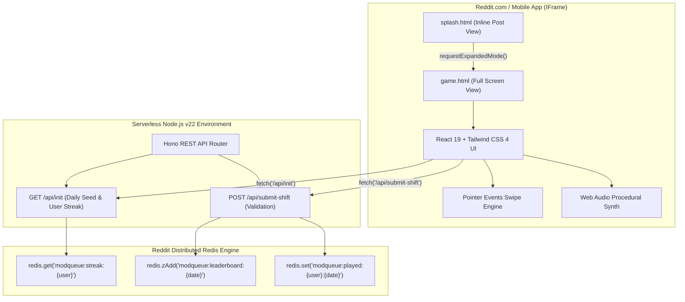

# 🛡️ ModQueue: Daily Shift

<div align="center">

[](https://developers.reddit.com/)
[](https://react.dev/)
[](https://www.typescriptlang.org/)
[](https://tailwindcss.com/)
[](https://nodejs.org/)
[]()
[](LICENSE)

**"Papers, Please" meets "Tinder" inside Reddit.**  
*You are an AutoMod rookie trying to survive a 60-second daily shift moderating satirical communities without causing a subreddit revolt.*

🎮 **[Play Live on Reddit (r/ModQueueDaily)](https://www.reddit.com/r/ModQueueDaily/?playtest=modqueue-daily-shift)** • 🏆 Built for **Reddit's Game of the Day Hackathon 2026** ($35,000 Prize Pool)

</div>

---

## 📖 Table of Contents

- [💡 Overview](#-overview)
- [🎮 Gameplay Loop](#-gameplay-loop)
- [🧠 Tricky Mod Scenarios](#-tricky-mod-scenarios)
- [🪐 The 5 Satirical Communities (135+ Cards)](#-the-5-satirical-communities-135-cards)
- [💬 Wordle-Style Reddit Comment Output](#-wordle-style-reddit-comment-output)
- [🏗️ System Architecture](#️-system-architecture)
- [🔊 Zero-Asset Procedural Web Audio Engine](#-zero-asset-procedural-web-audio-engine)
- [🛠️ Tech Stack](#️-tech-stack)
- [🚀 Local Development & Deployment](#-local-development--deployment)
- [🏆 Hackathon Judging Rubric Alignment](#-hackathon-judging-rubric-alignment)

---

## 💡 Overview

Every Redditor has had a post instantly vaporized by an AutoMod regex for a microscopic bracket mistake, or witnessed community moderators passionately debating obscure rules.

**ModQueue: Daily Shift** turns the comedic chaos of subreddit moderation into an addictive, tactile daily habit. Every 24 hours (synchronized via UTC reset), every player in the world is assigned to moderate a new community with 3 strict AutoMod rules. You have **60 seconds** to triage 15 submissions using single-thumb card swipes or keyboard hotkeys.

---

## 🎮 Gameplay Loop

```
  ┌───────────────────────────────────────────────────────────────┐
  │ 1. THE BRIEFING                                               │
  │    • Inspect Subreddit mascot, tagline & subscriber count     │
  │    • Study 3 active AutoMod directives + Ban Hammer criteria  │
  └───────────────────────────────┬───────────────────────────────┘
                                  ▼
  ┌───────────────────────────────────────────────────────────────┐
  │ 2. THE 60-SECOND QUEUE (Single-Thumb Swipes / Hotkeys)        │
  │    • 🟢 Swipe Right / [D] ➜ APPROVE (Meets all 3 rules)       │
  │    • 🔴 Swipe Left  / [A] ➜ REMOVE  (Breaks ≥1 rule)          │
  │    • 🔨 Swipe Up    / [W] ➜ BAN BOT (Negative karma spammer)  │
  └───────────────────────────────┬───────────────────────────────┘
                                  ▼
  ┌───────────────────────────────────────────────────────────────┐
  │ 3. DAILY CERTIFICATE & REDDIT SHARE                           │
  │    • Accuracy %, Time taken, Combo record & Mod Rank Title    │
  │    • 1-Click spoiler emoji grid to paste into Reddit comments │
  │    • Inspect Mistakes & Trap Breakdown accordion              │
  └───────────────────────────────────────────────────────────────┘
```

### Controls & Juiciness
* **Swipe Right (`[D]` / `→`)**: Slams an **`APPROVED ✓`** rubber stamp (Emerald glow).
* **Swipe Left (`[A]` / `←`)**: Slams a **`REMOVED ✗`** rubber stamp (Rose glow).
* **Swipe Up (`[W]` / `↑`)**: Slams the **`🔨 BANNED`** hammer (Purple neon).
* **Combo Multiplier**: Consecutive correct calls trigger escalating pentatonic chimes (`1x` ➔ `2x` ➔ `3x` ➔ `4x`).
* **Revolt Meter**: 3 wrongful moderator calls trigger community revolt warnings!

---

## 🧠 Tricky Mod Scenarios

Moderation isn't just about spotting obvious spam. *ModQueue* incorporates deceptive edge cases and traps that challenge your attention to detail:

1. **The 1-Unit Cutoff Trap**:
   * *Example*: `u/AlmostCenturion` has an account age of **99 days** when the rule requires $\ge 100$ days $\rightarrow$ `REMOVE`.
   * *Example*: `u/AlmostAristocrat` has **249 Karma** when aristocratic standing requires $\ge 250$ Karma $\rightarrow$ `REMOVE`.
2. **The Innocent Idiom / Regex Trap**:
   * *Example*: A ghost posts *"there is really no daylight between our haunt methods"* $\rightarrow$ AutoMod regex strictly flags the word `"daylight"` $\rightarrow$ `REMOVE`.
   * *Example*: An aristocratic cat sharpens claws on *"tree bark"* $\rightarrow$ AutoMod catches `"bark"` $\rightarrow$ `REMOVE`.
   * *Example*: Mentions street vendor *"hot dogs"* $\rightarrow$ triggers forbidden word `"dog"` $\rightarrow$ `REMOVE`.
3. **The Plural Tag Trap**:
   * *Example*: Post title starts with `[Questions]` (plural) instead of mandatory `[Question]` $\rightarrow$ `REMOVE`.
4. **The Mod Bait Trap**:
   * *Example*: A veteran 18,000 karma user posts `[Question] PSA: Beware of crypto spam in DMs!` $\rightarrow$ Hitting Ban on an authorized veteran causes an outrage strike! $\rightarrow$ `APPROVE`.
5. **The Stealth Disguised Spammer**:
   * *Example*: Polite formatting with a valid tag, but author has **`-45` Karma** and links affiliate gear in bio $\rightarrow$ `BAN HAMMER`.

---

## 🪐 The 5 Satirical Communities (135+ Cards)

| Subreddit | Theme | Mascot | Rules Enforced |
| :--- | :--- | :---: | :--- |
| **`r/AskGhosts`** | Afterlife Q&A forum | 👻 | `[Question]`/`[Haunt]` prefix • $\ge 100$d age • Zero mentions of "sunshine", "vacuum", "daylight" |
| **`r/CatsWithMonocles`** | Refined aristocratic felines | 🧐 | `[Sir]`/`[Lady]` prefix • $\ge 250$ Karma • Zero mentions of "dog", "bark", "woof" |
| **`r/ExplainLikeImAlien`** | Extraterrestrial sociology | 👽 | `[Specimen]`/`[Custom]` prefix • $\ge 30$d age • Zero references to "dollar", "crypto", "NFT" |
| **`r/MildlyRadioactive`** | Uranium glass & isotope hobbyists | ☢️ | `[Glow]`/`[Decay]` prefix • $\ge 50$d age • Zero mentions of "Chernobyl", "mutant", "lead" |
| **`r/TimeTravelerProblems`** | Chrononaut causality issues | ⏳ | `[Year: XXXX]` prefix • $\ge 150$ Karma • Zero mentions of "paradox", "dinosaur", "lottery" |

---

## 💬 Wordle-Style Reddit Comment Output

After finishing a shift, players click **"Share Result to Reddit Comments"** to copy a formatted spoiler block directly to their clipboard:

```markdown
🛡️ **ModQueue: Daily Shift** (r/CatsWithMonocles)
📅 `2026-11-15` | Rank: **⭐ Senior Subreddit Janitor**
📊 Accuracy: **93%** (14/15)
⏱️ Time: **38s** | 🔥 Streak: **6 Days**

🟩🟩🟩🔨🟩🟥🟩🟩🟩🔨🟩🟩🟩🟩🟩

*Played inside Reddit via Devvit*
```

---

## 🏗️ System Architecture



---

## 🔊 Zero-Asset Procedural Web Audio Engine

To ensure **0 KB download latency** and silky playback on cellular mobile data, all game audio is procedurally synthesized using the browser **Web Audio API**:

* **Approve Stamp**: Low-frequency resonant punch with decaying pitch curve ($160\text{ Hz} \rightarrow 30\text{ Hz}$).
* **Remove Rejection**: Dissonant dual-sawtooth buzz ($150\text{ Hz} + 158\text{ Hz}$).
* **Ban Hammer**: Heavy distorted square wave bass transient followed by a metallic anvil decay ($90\text{ Hz} \rightarrow 30\text{ Hz}$).
* **Combo Chimes**: Harmonious pentatonic scale ($C_5, D_5, E_5, G_5, A_5, C_6$) with high-Q bandpass filtering.

---

## 🛠️ Tech Stack

* **Platform**: Reddit Devvit Web (`@devvit/web`, `@devvit/cli`)
* **Frontend**: React 19, Tailwind CSS 4, Vite
* **Backend**: Hono serverless routing on Node.js v22
* **Storage**: Reddit Redis (`redis.get`, `redis.set`, `redis.zAdd`, `redis.zRange`)
* **Gestures**: HTML5 Pointer Events (`setPointerCapture`) with `touch-action: manipulation`
* **Audio**: Procedural Web Audio API (Zero external MP3 dependencies)
* **Testing**: Node.js Native Test Runner (`node --test`)

---

## 🚀 Local Development & Deployment

### Prerequisites
* **Node.js**: `v22.0.0` or higher
* **Devvit CLI**: `@devvit/cli` installed (`npx devvit`)

### 1. Install Dependencies
```bash
npm install
```

### 2. Run Test Suite & Linter
```bash
# Run unit tests
npm run test:unit

# Check TypeScript types
npm run test:types

# Run ESLint
npm run lint
```

### 3. Build Bundles
```bash
npm run build
```

### 4. Playtest Live on Reddit
```bash
# Log in to your Reddit developer account
npx devvit login

# Launch live hot-reloading playtest session
npx devvit playtest <YOUR_SUBREDDIT_NAME>
```

---

## 🏆 Hackathon Judging Rubric Alignment

| Judging Pillar | How ModQueue Excels |
| :--- | :--- |
| **1. Delightful UX** | Zero learning curve. Anyone understands swiping left/right within 3 seconds. Velocity-reactive stamps and procedural audio deliver immediate, tactile feedback. |
| **2. Polish** | Production-ready engineering. Strict TypeScript (`0 errors`), ESLint (`0 errors`), 6/6 unit test coverage, and a mobile layout with zero dynamic viewport white bleed. |
| **3. "Reddit-y"** | 100% authentic Reddit lore. Satirizes AutoMod, power mods, karma bots, and subreddit rules. Generates hilarious debates in comment sections. |
| **4. Recurring Content** | Deterministic UTC daily seed ensures every player worldwide plays the exact same daily shift. Daily streaks and comment spoiler grids drive daily retention. |

---

<div align="center">

Built with ❤️ by **[u/LeftistDinosaur](https://developers.reddit.com/apps/modqueue-daily-shift)** for the Reddit Game of the Day Hackathon 2026.

</div>
